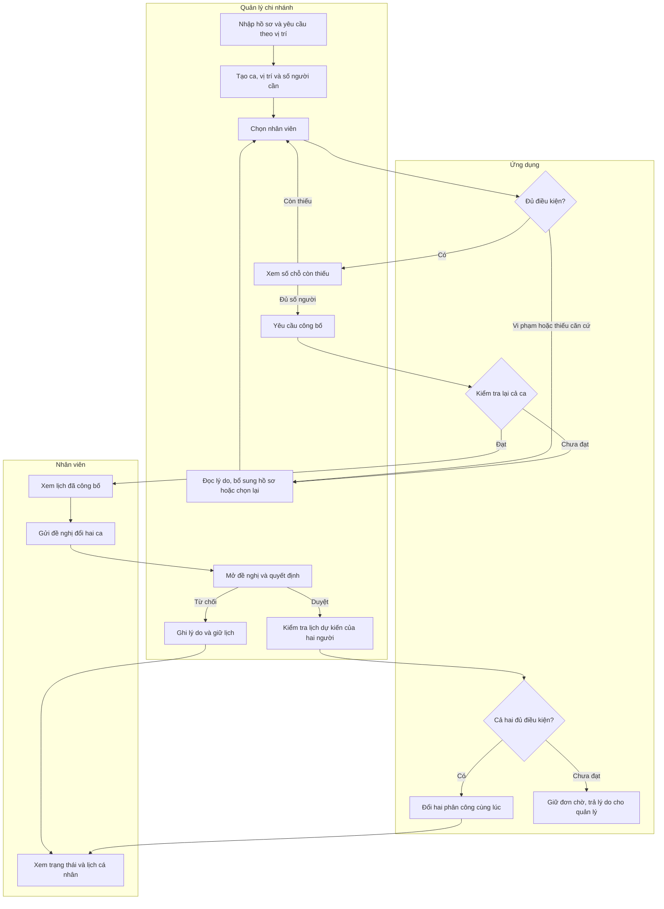

# Đặc tả yêu cầu DT05 · phiên bản xin duyệt

**Mục tiêu M2.** Đề nghị duyệt một ứng dụng web cho hai vai trò. Quản lý chuẩn bị hồ sơ và nhu cầu của chi nhánh, tự chọn người, hệ thống kiểm tra trước khi lưu hoặc công bố. Nhân viên xem lịch cá nhân và đề nghị hoán đổi hai ca. M3 trình diễn đến bước xem lịch. M4 bổ sung duyệt đổi và hoàn thiện các trường hợp đặc biệt. Xếp ca tối ưu tự động, chấm công, tính lương, ứng dụng di động riêng, lưu bản scan và triển khai Internet nằm ngoài ước tính kỳ này. [Đề bài DT05](https://docs.google.com/spreadsheets/d/1NY6msgE6lJuXRuEuBP4bVPVmSU7FKnFBtdhE9q2dKEU/edit?gid=97601406#gid=97601406&range=A9:H9)

### Quy trình đề xuất để nghiệp vụ đối chiếu

**Đối tượng và quyền.** Quản lý nhập hồ sơ nhân viên thuộc chi nhánh quản lý chính, xếp người được phép làm tại chi nhánh mình và duyệt đơn nội bộ chi nhánh. Đối với nhân viên được chia sẻ giữa hai chi nhánh, quản lý nơi nhận có thể xem tên, vị trí đủ điều kiện và lý do có thể phân công. Hệ thống xét xung đột trên toàn bộ lịch của người đó. Nhân viên chỉ sửa hành động do chính mình khởi tạo thông qua form gửi đơn, xem lịch của mình và kết quả đơn có liên quan. Tài khoản quản trị kỹ thuật được dùng để tạo tài khoản, phân vai và cấu hình danh mục.

### Yêu cầu chức năng và tiêu chí chấp nhận

| Mã | Thao tác và kết quả phải quan sát được | Mốc | Kiểm thử |
|---|---|---|---|
| YC01 | Đăng nhập nhận đúng vai trò. Kiểm tra quyền trên máy chủ cho cả đọc và ghi. Quản lý bị từ chối khi thao tác ngoài chi nhánh được giao. | M3 | T08, T11 |
| YC02 | Quản lý tạo/sửa hồ sơ có mã duy nhất, tên hiển thị, trạng thái làm việc, ngày bắt đầu, chi nhánh chính và nơi được phép nhận ca. Nhân viên ngừng hoạt động bị chặn khi phân mới. | M3 | T11 |
| YC03 | Ghi loại giấy, ngày hiệu lực, ngày hết hạn. Với công việc bếp, hệ thống tìm hồ sơ đúng loại, còn hiệu lực suốt ca. Trả lý do cụ thể khi giấy hết hạn. | M3 | T02, T13 |
| YC04 | Lưu căn cứ hướng dẫn ban đầu và lần hướng dẫn lại theo loại riêng, kèm ngày thực hiện và hạn hiệu lực nếu có. Chọn người thiếu đào tạo bắt buộc thì thấy loại cần bổ sung. | M3 | T03 |
| YC05 | Quản lý nhập chi nhánh, vị trí, thời điểm bắt đầu/kết thúc, khoảng nghỉ và số người cần. Một ca đại diện cho một vị trí. Danh sách tuần hiển thị đã xếp/cần. | M3 | T01, T12 |
| YC06 | Thêm hoặc bỏ một người ở ca nháp. Ngăn trùng người, trùng khung giờ, vượt số chỗ hoặc người không được làm tại chi nhánh. Tải lại trang vẫn thấy đúng số phân công. | M3 | T01, T04, T14 |
| YC07 | Khi xếp ca, kiểm tổng giờ và khoảng nghỉ với ca ở cả hai phía, dùng mọi chi nhánh. Nêu số thực tế và ngưỡng khi bị chặn. | M3 | T05, T06, T13 |
| YC08 | Với thay đổi ảnh hưởng Chủ nhật, kiểm quỹ ngày nghỉ trong năm từ dữ liệu giả lập đủ kỳ. Phân biệt số ngày dưới ngưỡng và kỳ chưa đủ dữ liệu. | M3 | T07 |
| YC09 | Công bố một ca khi đủ người và từng phân công đạt quy tắc tại lúc công bố. Nếu có lỗi thì ca vẫn nháp. Lịch nhân viên lọc theo tuần và người đăng nhập. | M3 | T01, T08, T12 |
| YC10 | Nhân viên chọn ca tương lai của mình đã công bố, nhập mã phân công đối tác đã cung cấp, gửi yêu cầu nội bộ cùng chi nhánh. Hệ thống lưu hai phân công và chủ sở hữu tại lúc gửi. | M4 | T09, T15 |
| YC11 | Quản lý duyệt trên dữ liệu mới nhất của hai người. Nếu đạt, đổi cả hai lịch trong một giao dịch. Nếu từ chối, lưu lý do và người quyết định. Mỗi bên thấy kết quả. | M4 | T09, T10, T14, T15 |

### Quy tắc dùng cho bản mô phỏng

Các quyết định Q1–Q6 dưới đây cần nghiệp vụ xác nhận. Các ví dụ kiểm thử áp dụng cho phương án đề xuất. Các hồ sơ đều là dữ liệu hư cấu.

| Quyết định | Phương án nhóm dùng để ước tính | Ví dụ hoặc ranh giới |
|---|---|---|
| Q1 · Điều kiện hồ sơ | Nhân viên hoạt động, được làm ở chi nhánh, có đủ loại bằng chứng theo vị trí. Hồ sơ xét từ ngày đầu đến hết ngày địa phương cuối cùng thực sự làm. Bản ghi thiếu dữ kiện hiện rõ mục cần bổ sung. | Giấy hết hạn 22/11 chặn ca 23/11. Giấy hết hạn 23/11 dùng được đến hết ngày 23. Với hướng dẫn vệ sinh, lưu ngày bắt đầu làm, chứng nhận ban đầu đã được nghiệp vụ xác minh và bằng chứng hướng dẫn tiếp theo. |
| Q2 · Ngày làm và nghỉ | Bản demo cho người trưởng thành, một ca là một đợt làm việc, có thể chứa khoảng nghỉ. Trần nội bộ 480 phút làm thực cho cả ca và tổng trên từng ngày lịch địa phương. Hai ca riêng cách nhau ít nhất 660 phút. Ca qua đêm chia phút theo ngày và trừ nghỉ đúng khoảng. | Hai đoạn trong cùng ca dùng khoảng nghỉ nội ca. Khi người dùng yêu cầu ca gãy hoặc cơ chế bù bình quân, cần nghiệp vụ quy định riêng trước khi mở rộng. |
| Q3 · Chủ nhật | Với người có ca bị thêm/bớt vào Chủ nhật, tính số Chủ nhật nghỉ dự kiến của từng năm bị tác động. Ngưỡng demo là 15. Thiếu lịch nền cho một ngày cần xét trả “Thiếu dữ liệu”; chặn ghi cho đến khi bổ sung. | Dữ liệu nền tách thời gian làm khác khỏi các ca ứng dụng quản lý để tránh đếm hai lần và cho phép trả lại một ngày nghỉ sau khi đổi. Ngày nghỉ bù và ngoại lệ ngành cần thống nhất phạm vi riêng. |
| Q4 · Công bố | Lưu ca nháp thiếu người. Công bố từng ca khi đúng số lượng và điều kiện. Ca đã công bố cố định giờ, vị trí và nhu cầu. Nhánh thay nhân sự trong bản đầu đi qua đề nghị đổi. | Ca cần 2 mà đã xếp 1 vẫn nháp. Hồ sơ mất hiệu lực sau khi lưu nháp sẽ bị phát hiện khi công bố. |
| Q5 · Hoán đổi | Hai nhân viên trao đổi mã phân công của hai ca khác nhau trong cùng chi nhánh. Một người gửi, quản lý duyệt. Mã cho phép chỉ định đúng ca đối tác mà vẫn giữ riêng lịch cá nhân. | Đơn chờ chưa tác động lịch. Nếu nhân sự đã đổi kể từ lúc gửi, quản lý thấy yêu cầu đã lỗi thời và có thể từ chối, nhân viên lập yêu cầu mới. Cần hỏi có bắt buộc nút xác nhận riêng của đối tác hay không. |
| Q6 · Phạm vi quản lý | Một nhân viên có một chi nhánh chủ quản và có thể làm ở nhiều chi nhánh. Quyền xem hồ sơ chi tiết và quyền phân ca theo bảng phân quyền trong thiết kế. | Quản lý CN02 có thể nhận thông báo “trùng lịch ở chi nhánh khác” mà vẫn giữ riêng thông tin ca của CN01. |

**Căn cứ để người phụ trách đối chiếu.** ArbZG §§3–5 có điều kiện về thời lượng, nghỉ giữa giờ và nghỉ sau ngày làm việc. §§10–12 đề cập làm Chủ nhật, nghỉ bù và ngoại lệ. IfSG §43 phân biệt chứng nhận ban đầu và hướng dẫn định kỳ của người sử dụng lao động. Đề xuất ở Q1–Q3 giản lược các nội dung này cho bài thực tập. Trong cuộc họp, ghi rõ phạm vi nào được chấp nhận và ai xác minh ngày hiệu lực hồ sơ. [ArbZG](https://www.gesetze-im-internet.de/arbzg/ArbZG.pdf) · [IfSG §43](https://www.gesetze-im-internet.de/ifsg/__43.html)

### Yêu cầu chất lượng

| Mã | Điều cần bảo đảm | Cách nghiệm thu đề xuất |
|---|---|---|
| CL01 | Tài khoản nhân viên chỉ đọc được lịch phù hợp. Thông báo lỗi liên chi nhánh chỉ tiết lộ thông tin cần thiết. | Chạy T08, T11 với hai tài khoản và hai chi nhánh. |
| CL02 | Một thao tác duyệt có hiệu lực tối đa một lần. Hai yêu cầu đến đồng thời vẫn giữ đúng sức chứa và người nhận ca. | Chạy T14 trên hai phiên SQL Server độc lập và xem lại dữ liệu sau giao dịch. |
| CL03 | Lưu được ai công bố, ai duyệt/từ chối, lúc nào và phân công nào đã đổi. | Theo một đơn từ trước khi gửi đến sau khi xử lý ở T09/T10. |
| CL04 | Cài đặt lặp lại được từ repo, migration và dữ liệu giả lập trên hai máy. | M5 đối chiếu số nhân viên, số chi nhánh và kết quả T01/T02 trên cả hai máy. |
| CL05 | Người dùng biết vì sao bị chặn và bước tiếp theo. Lịch hiển thị giờ Đức, ngày qua đêm và số chỗ còn thiếu bằng chữ/số. | Chung đưa T02, T07, T13 cho người thử. Họ chỉ ra được trường nào cần sửa và ca nào chưa công bố. |
