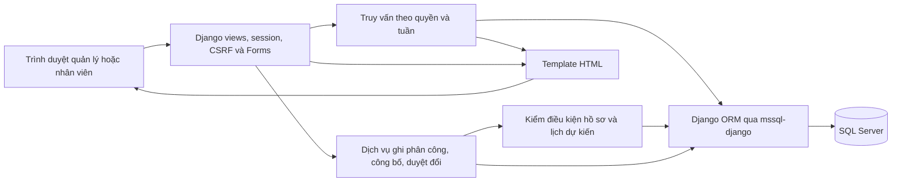
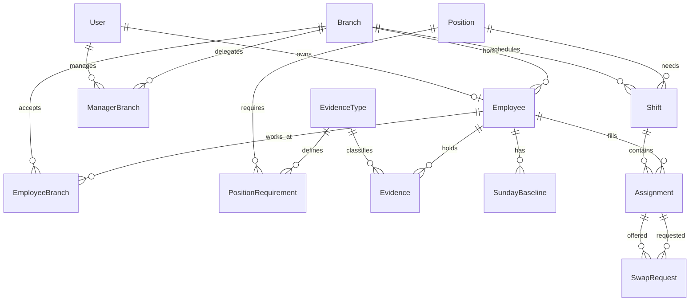

# Thiết kế hệ thống · Django 5.2 và SQL Server

**Kiến trúc.** Một ứng dụng Django phục vụ HTML cho cả hai vai trò. Mọi thao tác ảnh hưởng lịch đi qua cùng lớp xử lý nghiệp vụ. SQL Server giữ hồ sơ, ca, phân công và đơn đổi. Mỗi máy phát triển dùng database riêng. Cấu hình host và driver đọc từ môi trường. [Hướng dẫn cài đặt của nhóm](../BAT_DAU_DT05.md) · [Backend SQL Server của Microsoft](https://github.com/microsoft/mssql-django)



### Mô hình dữ liệu

Sơ đồ dùng tên model để hai bạn đặt tên thống nhất khi tạo migration. Django cung cấp User, Group và quyền cơ bản. Quan hệ quản lý chi nhánh được kiểm riêng trên mỗi thao tác.



**Từ điển dữ liệu.** Dùng khóa chính số nguyên lớn do hệ quản trị sinh, khóa ngoại cùng kiểu, mã nghiệp vụ duy nhất và nhãn tiếng Việt dạng Unicode. Kiểu ngày thuần cho ngày hiệu lực, thời điểm có quy ước UTC cho lịch và lịch sử. Cột cho phép trống được ghi rõ bên dưới.

| Model | Trường nghiệp vụ và khóa | Ràng buộc, mục đích |
|---|---|---|
| Branch, Position | code, name | UNIQUE(code) theo từng bảng. Ví dụ CN01 và BEP. |
| ManagerBranch | user_id, branch_id | UNIQUE(user_id, branch_id). Kết hợp vai trò quản lý với phạm vi cụ thể. |
| Employee | code, display_name, user_id có thể trống, home_branch_id, started_on, active | UNIQUE(code). OneToOne với User khi gắn tài khoản, unique có điều kiện với user_id khác NULL trên SQL Server. |
| EmployeeBranch | employee_id, branch_id | UNIQUE(employee_id, branch_id). Thêm cả chi nhánh chính khi tạo hồ sơ. |
| EvidenceType | code, name, category, expiry_required | Mã riêng cho giấy theo vị trí, chứng nhận vệ sinh ban đầu và lần hướng dẫn lại. category nhận DOCUMENT hoặc TRAINING. |
| PositionRequirement | position_id, evidence_type_id | UNIQUE theo cặp. Mỗi loại là một điều kiện bắt buộc của vị trí. |
| Evidence | employee_id, evidence_type_id, issued_on, valid_from, valid_until có thể trống, reference, verified_by | Ghi nhiều lần gia hạn. Ngày kết thúc từ ngày bắt đầu trở đi. Hạn trống chỉ hợp lệ với loại cho phép. reference là mã chứng từ giả. Lưu tài khoản xác minh. |
| SundayBaseline | employee_id, sunday_date, worked_elsewhere | UNIQUE(employee_id, sunday_date). Mỗi hàng xác nhận có/không có làm việc ngoài các ca ứng dụng quản lý vào Chủ nhật đó. Thiếu hàng là chưa biết. Kiểm tra thứ của ngày khi nhập. |
| Shift | code, branch_id, position_id, start_at, end_at, break_start/break_end có thể trống, required_count, status, published_at/published_by có thể trống | UNIQUE(code), required_count > 0, end_at > start_at. Một khoảng nghỉ ở bản đầu, có đủ hai đầu, nằm trong ca và ngắn hơn ca. DRAFT hoặc PUBLISHED. |
| Assignment | public_code, shift_id, employee_id | UNIQUE(public_code), UNIQUE(shift_id, employee_id). Mã chia sẻ sinh ngẫu nhiên khó đoán. ID phân công gắn với chỗ trong ca và giữ ổn định khi đổi người. |
| SwapRequest | assignment_a_id, assignment_b_id, original_a_employee_id, original_b_employee_id, created_by, created_at, status, decided_by/decided_at/reason có thể trống | Hai phân công và hai người khác nhau. PENDING, APPROVED hoặc REJECTED. Lưu chủ sở hữu ban đầu để phát hiện đơn cũ và tra lịch sử sau khi đổi. |
| ScheduleGate | id | Một hàng cố định id=1, tạo bằng data migration. Dùng để tuần tự hóa thao tác ghi lịch trong bản thực tập ít người dùng. |

Tạo chỉ mục cho Shift(branch_id, start_at), Assignment(employee_id, shift_id), Evidence(employee_id, evidence_type_id, valid_from) và SwapRequest(status, created_at). Dùng FK bảo vệ hồ sơ đã được tham chiếu và đánh dấu nhân viên ngừng hoạt động khi nghỉ việc. member, branch, employee trong ví dụ màn hình được suy ra từ bản ghi và tài khoản đăng nhập. Các kiểm tra liên quan nhiều hàng như sức chứa và ca trùng được thực hiện trong giao dịch.

### Màn hình và điểm vào

| Màn hình | Đường dẫn đề xuất và thao tác | Quyền và phản hồi |
|---|---|---|
| Đăng nhập | GET/POST /login/ dùng Django Auth | Người dùng hợp lệ vào lịch phù hợp vai trò. |
| Danh sách và hồ sơ | GET /nhan-su/ và /nhan-su/{id}/; POST cập nhật hồ sơ hoặc thêm minh chứng | Quản lý chính sửa. Hiện trạng thái, ngày hết hạn và loại còn thiếu. Bộ lọc chi nhánh chạy trên máy chủ. |
| Lịch chi nhánh | GET /lich/?chi_nhanh=CN01&tuan=2026-11-23; GET/POST /ca/tao/ | Quản lý chọn tuần, thấy mỗi dòng gồm ngày, vị trí, giờ, số đã xếp/cần, trạng thái. Tuần rỗng có nút tạo ca. |
| Chi tiết ca | GET /ca/{id}/; POST /ca/{id}/phan-cong/, /ca/{id}/bo-phan-cong/, /ca/{id}/cong-bo/ | Quản lý của ca. Chọn ứng viên từ chi nhánh được phép. Hiện lỗi cạnh ô chọn. Sau thành công chuyển về chi tiết và đọc số người từ DB. |
| Lịch cá nhân | GET /lich-cua-toi/?tuan=… | Máy chủ suy ra nhân viên từ User. Chỉ trả phân công đã công bố. Ca tương lai có mã phân công của chính mình và nút đề nghị đổi. |
| Gửi đơn và xem kết quả | GET/POST /doi-ca/tao/; GET /doi-ca/cua-toi/ | Nhân viên chọn phân công của mình, nhập mã đối tác. Chỉ hiển thị phần cần cho giao dịch, kiểm quyền ở cả POST. |
| Duyệt | GET /quan-ly/doi-ca/; POST /quan-ly/doi-ca/{id}/duyet/ hoặc /tu-choi/ | Quản lý chi nhánh hai ca. Thấy lịch trước/sau dự kiến, lý do thất bại hoặc quyết định đã ghi. |

Ví dụ CA01 trên màn hình quản lý hiện **Bếp · 23/11 · 09:00–17:30 · Nháp · 0/2 người**. Chọn NV02 thì ngay dưới nút lưu hiện “Giấy điều kiện bếp của NV02 hết hạn ngày 22/11. Hãy cập nhật hồ sơ hoặc chọn người khác.” Chọn NV01 hợp lệ thì số đã xếp đổi thành **1/2**. Nhân viên chỉ thấy CA01 sau khi đủ người và quản lý công bố.

### Hợp đồng giữa phần của Hiệp và Chung

Chung viết forms/views/templates trong app lichca. Hiệp viết models, migration, hàm kiểm tra và các hàm ghi nghiệp vụ. Kiểm tra theo phạm vi trong view để dựng màn hình và lặp lại ở dịch vụ ghi để bảo vệ mọi đường vào. Hai người thống nhất chữ ký ở mức thiết kế sau.

| Hàm | Đầu vào | Đầu ra và tác động |
|---|---|---|
| evaluate_assignment | Nhân viên, ca, lịch dự kiến sau thay đổi, ngày đánh giá | Trả kết quả và danh sách lý do. Chỉ đọc dữ liệu. |
| assign_employee / remove_assignment | Người thao tác, mã ca, mã nhân viên hoặc phân công | Kiểm quyền và trạng thái nháp. Khi thêm, kiểm điều kiện và sức chứa. Trả phân công và số người sau giao dịch. |
| publish_shift | Người thao tác, mã ca | Kiểm lại toàn bộ ca. Khi đạt thì ghi người và thời điểm công bố. |
| request_swap | Người gửi, mã phân công của mình và của đối tác | Kiểm quyền sở hữu, cùng chi nhánh, hai ca tương lai đã công bố, hai người khác nhau. Chặn đơn chờ trùng cùng cặp kể cả thứ tự đảo. Lưu yêu cầu chờ. |
| decide_swap | Người duyệt, mã đơn, quyết định, lý do nếu từ chối | Kiểm lại quyền, trạng thái và lịch. Đơn đã xử lý trả kết quả đang lưu, không áp dụng thay đổi lần hai. |

Ví dụ kết quả từ evaluate_assignment khi chọn NV02 cho CA01:

```json
{"status":"BLOCKED","issues":[{"code":"DOCUMENT_EXPIRED","employee":"NV02","field":"valid_until","actual":"2026-11-22","required_through":"2026-11-23","message":"Giấy điều kiện bếp của NV02 hết hạn ngày 22/11."}]}
```

Ba kết quả là OK, BLOCKED và NEED_DATA. Khi cùng có lỗi chắc chắn và dữ liệu còn thiếu, trả BLOCKED kèm toàn bộ lý do được phép hiển thị. Nếu chỉ thiếu dữ liệu, trả NEED_DATA. Cả hai kết quả sau đều giữ nguyên phân công. Form sai định dạng trả lỗi trường trước khi gọi quy tắc. Mã lỗi nghiệp vụ dùng thống nhất cho màn hình và kiểm thử.

### Thứ tự kiểm tra lịch dự kiến

1. Chuẩn hóa ngày giờ theo Europe/Berlin, lưu UTC và hiển thị lại giờ Đức. Khoảng thời gian dùng quy ước [bắt đầu, kết thúc). Với giờ chuyển mùa bị lặp hoặc không tồn tại, form yêu cầu chọn thời điểm có độ lệch UTC rõ ràng hoặc sửa giờ. Thời lượng tính bằng phút đã trôi qua. Ngày hết hạn và Chủ nhật xét theo lịch Đức.
2. Tạo tập phân công dự kiến từ cả nháp và đã công bố của những người liên quan ở mọi chi nhánh. Khi kiểm một phân công đã lưu, loại chính bản ghi đó trước khi thêm ứng viên. Khi đổi, thay cả hai phân công trong bản dự kiến trước khi kiểm ai. Khi xét lịch cá nhân chỉ hiển thị lịch đã công bố.
3. Xác nhận trạng thái nhân viên, quyền nhận ca tại chi nhánh, đủ hồ sơ theo vị trí phủ thời gian ca. Có giấy sai hạn trả DOCUMENT_EXPIRED, thiếu bằng chứng bắt buộc trả EVIDENCE_MISSING. Thiếu trường để xác minh trả NEED_DATA. Đợt hướng dẫn ban đầu và hướng dẫn lại được đối chiếu theo dữ liệu đã xác minh ở Q1.
4. Hai khoảng trùng khi đầu A < cuối B và đầu B < cuối A. Khoảng nghỉ được coi là thời gian vẫn thuộc ca khi xét trùng. Sau đó so ca liền trước và liền sau với mức nghỉ Q2, trả OVERLAP hoặc REST_SHORT. Cộng phút làm thực của các phần ca giao với từng ngày địa phương, trừ phần nghỉ giao với ngày đó. So trần cho cả ca và từng ngày, trả HOURS_EXCEEDED.
5. Với ca chạm Chủ nhật, xác định ngày có phút làm thực. Lấy tất cả Chủ nhật của năm đó, một ngày được tính làm nếu baseline ghi làm hoặc lịch dự kiến có phút làm ngày đó. Nhiều ca cùng ngày chỉ tính một lần. Thiếu một hàng nền trả SUNDAY_DATA_MISSING; đủ dữ liệu nhưng dưới ngưỡng trả SUNDAY_QUOTA. Kiểm cả hai năm nếu thay đổi tác động hai năm. Ca ngày thường không đòi hồ sơ Chủ nhật cho năm không bị tác động.
6. Đếm phân công riêng biệt. Thêm người khi ca đã đủ trả CAPACITY_FULL. Công bố khi số lượng chưa đúng trả HEADCOUNT_MISMATCH. Chỉ ghi dữ liệu sau khi toàn bộ điều kiện của thao tác đạt.

### Trạng thái và tính nhất quán trên SQL Server

| Từ | Sự kiện | Kết quả |
|---|---|---|
| Ca DRAFT | Thêm, bỏ hoặc sửa giờ/nhu cầu | Ca vẫn nháp. Nếu sửa giờ/nhu cầu của ca đã có người, kiểm lại tất cả và từ chối thay đổi khi không đạt. |
| Ca DRAFT | Công bố thành công | PUBLISHED, lưu người và giờ công bố. Công bố lặp trả trạng thái đã có. |
| Ca PUBLISHED | Duyệt một hoán đổi hợp lệ | Ca vẫn công bố, đổi người ở hai vị trí. Giữ số lượng. |
| Đơn PENDING | Bấm từ chối cùng lý do | REJECTED, giữ lịch. |
| Đơn PENDING | Duyệt vào lịch hợp lệ | APPROVED, đổi đúng hai phân công và lưu quyết định cùng giao dịch. |
| Đơn PENDING | Bấm duyệt khi sai quyền, ca đã bắt đầu, chủ sở hữu đã đổi hoặc kiểm tra thất bại | Giữ dữ liệu, trả nguyên nhân trong phạm vi được xem. Quản lý có thể từ chối và ghi lý do. |

Với hai quản lý cùng thêm người vào chỗ cuối, chỉ bọc thao tác đếm và ghi trong transaction mức mặc định vẫn có thể cho cả hai đọc cùng số chỗ. Với quy mô demo, chọn cách đơn giản: trong transaction.atomic(), khóa hàng ScheduleGate trước khi đọc các điều kiện, dùng SELECT có UPDLOCK, HOLDLOCK trên khóa chính rồi chỉ nhả khi kết thúc giao dịch. Sau đó đọc lại quyền, hồ sơ, lịch, sức chứa, trạng thái và chủ sở hữu. Cùng quy ước này áp dụng cho các đường ghi làm thay đổi kết quả kiểm tra, kể cả sửa hồ sơ, lịch nền hoặc quyền nghiệp vụ. Dùng tham số khi truyền dữ liệu vào SQL. Trang quản trị kỹ thuật chỉ đọc các bảng nghiệp vụ hoặc gọi cùng dịch vụ. Thiết kế một hàng khóa phù hợp tải demo, đổi lại các thao tác ghi lịch phải lần lượt chờ nhau. [Giao dịch Django](https://docs.djangoproject.com/en/5.2/topics/db/transactions/) · [Khóa bảng và hàng trên SQL Server](https://learn.microsoft.com/en-us/sql/t-sql/queries/hints-transact-sql-table)

Khi duyệt, đọc lại hai Assignment, so với chủ sở hữu gốc và dựng lịch dự kiến. Nếu một người đã có chỗ khác trong ca đích, trả lỗi trùng phân công. Ghi chủ mới cho hai hàng rồi cập nhật quyết định. Lỗi ở bất kỳ bước nào phải rollback cả hai. Đọc lịch sau commit bằng truy vấn mới. Nếu hồ sơ đã đổi sau công bố, lúc xem chi tiết quản lý hiển thị cảnh báo cần rà soát cho ca sắp tới. Thao tác duyệt đổi luôn đánh giá lại điều kiện của lịch mới. Quy trình thay thế khẩn cấp ngoài luồng hoán đổi đưa vào phiếu Q4 để đơn vị quyết định.

### Thứ tự thực hiện trên máy nhóm

Bắt đầu bằng Django auth, models danh mục và migration. Tiếp theo nạp bộ mẫu theo mã, triển khai evaluate_assignment cùng T02, rồi nối form phân ca và các quy tắc còn lại. Mở công bố và lịch nhân viên khi kiểm tra thực sự chạy phía máy chủ. Cuối cùng thêm đơn đổi, thử hai phiên đồng thời, cài lại trên máy thứ hai và ghi kết quả. Chốt cấu hình thật của SQL Server bằng cách kết nối, chạy migration và kiểm tra bảng trên từng máy.
